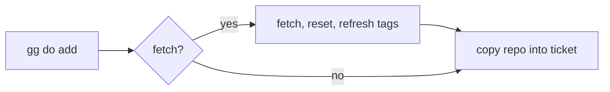

<!--
@license
Copyright (c) ggsuite

Use of this source code is governed by terms that can be
found in the LICENSE file in the root of this package.
-->

# Copy Ocean Repos As They Are With --no-fetch

## Motivation

- gg checks a repo before it is committed, pushed and published.
- On Windows, the check of gg_multi_workspace did not finish.
- The test "WorkspaceRepoHost addWithAddCommand() copies the ocean repo
  into the ticket, once" hung for three minutes inside gg's check.
- Developers on Windows could not commit their work with gg.
- The goal: `gg one can commit` passes on Windows as it does elsewhere.

## Strategy

- Find out what the hanging test waits for.
- Make `gg do add --no-fetch` keep the promise its help already makes.
- Let the tests that need symbolic links skip where links are not
  available.
- Follow the approach gg_multi_core already uses for symbolic links.

## Finding the Hang

- A process snapshot showed a running `git fetch` against
  `https://github.com/ggsuite/gg_new.git`.
- That repository does not exist.
- git-credential-manager waited there for an interactive login.
- In a plain test run without a console the credential manager gave up
  at once, so the problem never showed up.
- Under gg it had a console and waited, so the test hung.

## Implementation 1: --no-fetch Skips the Fetch

- Before, `--no-fetch` only applied to the transitive manifest scan.
- Its help already said "Bring the repos this run reasons about to
  origin/<default branch> first".
- The ocean repo was still fetched, reset to origin/<default branch>
  and got its tags refreshed before it was copied into the ticket.
- Now `--no-fetch` skips all three steps; the repo is copied as it is.
- The `fetch` flag is passed through `_copyReposToTicket` and
  `_copyRepoToTicket`.
- `_prepareOceanRepositoryForCopy` runs only when `fetch` is set.
- The new test "copies the ocean repo as it is with --no-fetch" verifies
  that neither `git fetch` nor `git reset` runs.

## Implementation 2: Tests Without Symbolic Links

- Windows without Developer Mode cannot create symbolic links.
- Like gg_multi_core, the new `test/symlinks.dart` offers
  `canCreateSymlinks` and `skipWithoutSymlinks`.
- The tests "replaces a link of the same name" and "copies a link as a
  link" skip where links cannot be created.
- The hooks test now creates its link only where possible.
- The link branch of `_copyClaudeFolder` in `workspace_dna.dart` is
  excluded from coverage, since it cannot run everywhere.

## Result

- `gg one can commit` passes on Windows.
- `--no-fetch` now means no network access for the copied repos.
- The change is released as a minor version.

## Open Points

- The link tests still skip on Windows without Developer Mode.
- Without `--no-fetch`, a fetch can still wait for a login when a
  remote asks for credentials.
