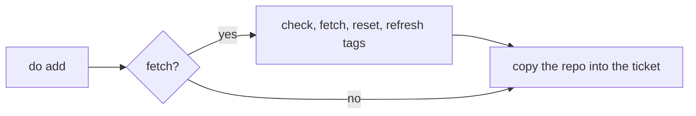

<!--
@license
Copyright (c) ggsuite

Use of this source code is governed by terms that can be
found in the LICENSE file in the root of this package.
-->

# Copy ocean repos as they are with --no-fetch

## Motivation

- The checks of this repo should pass on Windows as on macOS and Linux
- On Windows, `gg one can commit` did not finish: the test
  "WorkspaceRepoHost addWithAddCommand() copies the ocean repo into the
  ticket, once" hung for three minutes
- A process snapshot showed a `git fetch` against
  `https://github.com/ggsuite/gg_new.git`, a repo that does not exist
- git-credential-manager waited there for an interactive login
- `addWithAddCommand` runs `do add --no-fetch`, so no fetch was expected
- Tests with symbolic links failed on Windows without Developer Mode

## Strategy

- Let `do add --no-fetch` keep the promise its help already makes
- Copy an ocean repo untouched when no fetch is asked for
- Let the tests that need symbolic links skip where none can be created
- Exclude the link branch of the code from coverage

## Implementation 1: --no-fetch skips the fetch

- Before, `--no-fetch` only skipped the refresh of the dependency scan
- The ocean repo was still checked for uncommitted changes, fetched,
  reset to `origin/<default branch>` and got its tags refreshed
- Now `_copyRepoToTicket` runs `_prepareOceanRepositoryForCopy` only when
  `fetch` is set; `_copyReposToTicket` passes the flag through
- With `--no-fetch`, the repo is copied as it is, uncommitted changes
  included, since no reset can throw them away
- The new test "copies the ocean repo as it is with --no-fetch" verifies
  that neither `git fetch` nor `git reset` runs
- The README describes both modes of `do add`

## Implementation 2: Tests without symbolic links

- Windows creates symbolic links only in Developer Mode or with
  administrator rights
- New test helper `test/symlinks.dart` with `canCreateSymlinks` and
  `skipWithoutSymlinks`
- "replaces a link of the same name" and "copies a link as a link" skip
  where links cannot be created
- "merges the hooks into the settings of the root" adds its link only
  where possible and checks the other files everywhere
- The link branch of `_copyClaudeFolder` in `workspace_dna.dart` is
  excluded from coverage, Windows reaches it in Developer Mode only

## Dependency updates

- `dna_ggsuite` moves from `^0.5.0` to `^1.0.0`; the regenerated guides
  and skills bring:
- A `/gg-review` skill: blog posts and the README are written before the
  pull requests, no longer at publish time
- Claude Code hooks that keep the prompts of a ticket in its project
  management repo
- New rules in the AI guide: keep every repo in its scope, keep
  `index.jsonc` up to date, describe every repo in its own terms
- The lock moves to `gg_multi_core` 4.11.1, which keeps a `.git` inside
  repository names of SSH and `org/repo` targets

## Result

- `gg one can commit` passes on Windows
- `do add --no-fetch` no longer touches the network for the repos it copies

## Open Points

- The link tests still skip on Windows without Developer Mode
- Without `--no-fetch`, a fetch can still wait for a login when a remote
  asks for credentials
- Missing dependencies are still cloned into the ocean with `--no-fetch`
